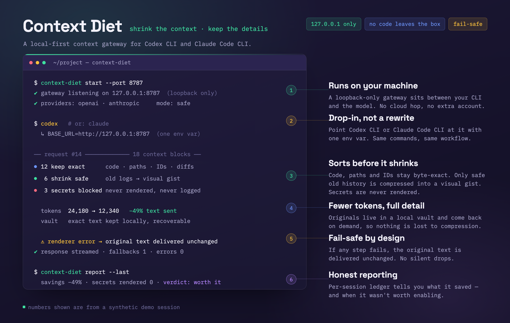

# Fixel Recall

**Make coding-agent context cheaper, safer and easier to understand.**

Fixel Recall is a local Safe-mode gateway for coding agents. It gives Codex CLI and Claude Code CLI
local routing, safety controls, diagnostics and reversible configuration. Context compression is an
in-development capability and is not currently performed on every live provider request.

<p align="center">
  
</p>

Think of it as a local nutrition label for your agent context:

- What is useful?
- What is old or repetitive?
- What must stay exact?
- What might be unsafe to transform?
- Did the change actually save anything?

## Why Developers Care

Long coding-agent sessions can quietly collect a lot of baggage: old chat, repeated tool output,
logs, file snippets, previous attempts and context that no longer matters. That can make requests
larger, slower, more expensive and harder for the model to reason about.

Fixel Recall currently helps by:

- routing supported CLI traffic through a local loopback gateway
- keeping code, commands, paths, IDs, hashes, secrets and active tool state protected
- providing local status, safety controls, rollback and uninstall
- preserving exact context through local retrieval components when configured
- testing and measuring future context-reduction behavior with synthetic fixtures
- supporting both Codex CLI and Claude Code CLI through one local engine

The goal is to make context reduction safe and evidence-based before enabling it in the live
gateway.

## Shrink The Context. Keep The Details.

Fixel Recall is designed to turn eligible old context into compact image memory while exact text
stays protected and recoverable. That transformation is currently in development and is not claimed
as active for every live request.

It is not just compression. Instead of sending every old message, log and repeated note back to the
model as text, Fixel Recall decides what can safely become a compact visual memory.

- Current instructions, code, commands, paths, IDs, hashes and secrets stay as native text.
- Secrets are never rendered.
- The local vault keeps authorised original text for exact recovery.
- MCP retrieval can fetch a narrow exact section later.
- pxpipe sits behind the renderer interface for the in-development rendering path.
- If rendering fails, the original text is preserved.
- Image compression will only happen when policy says it is safe and worthwhile.

### Current Gateway Reality

The live gateway currently provides local routing, authentication forwarding, request limits,
streaming, kill-switch controls, Safe mode, privacy-safe metrics and reversible setup. The firewall,
renderer and vault are implemented as protected components and testable interfaces, but they are not
yet connected to transform every live `/v1/responses` or `/v1/messages` request. Until that wiring
is complete, supported requests are forwarded unchanged.

## What This Adds Around OpenAI And Anthropic

OpenAI and Anthropic provide the models and coding agents. Fixel Recall adds a local product layer
around them:

- provider-neutral context policy across Codex CLI and Claude Code CLI
- a local gateway for OpenAI Responses-shaped and Anthropic Messages-shaped traffic
- an Exactness Firewall for code, commands, paths, IDs, hashes, versions, numbers, dates, URLs,
  secrets and other exact values
- local vault and MCP retrieval for narrow exact recovery
- reason codes that explain every policy decision
- synthetic and canary benchmark evidence
- local install, rollback and uninstall safeguards
- dashboard-ready metrics and context summaries

Fixel Recall does not replace OpenAI or Anthropic. It helps developers use coding agents with more
visibility, safety and cost awareness.

## Trust And Safety At A Glance

- **Loopback only by default:** the gateway binds to `127.0.0.1`; see
  [`packages/proxy/src/index.ts`](packages/proxy/src/index.ts).
- **Credentials stay in memory:** provider headers are forwarded only when needed and are never
  stored or printed; see [`copyProviderHeaders`](packages/proxy/src/index.ts).
- **No raw request-body logging:** structured events contain route, status, size and timing, never
  request bodies; see [`packages/proxy/src/index.ts`](packages/proxy/src/index.ts).
- **No telemetry service:** the gateway talks only to the configured, allowlisted provider endpoint;
  it does not send analytics elsewhere.
- **Rollback and uninstall:** configuration changes are recorded in a local manifest and can be
  restored; see [`docs/INSTALLER_ROLLBACK_DESIGN.md`](docs/INSTALLER_ROLLBACK_DESIGN.md).

These are repository claims, not a third-party security audit. The self-review is documented in
[`SECURITY_REVIEW.md`](SECURITY_REVIEW.md), and the regression coverage includes credential and
raw-body absence checks in
[`packages/proxy/src/subscription.test.ts`](packages/proxy/src/subscription.test.ts) and
[`tests/security/`](tests/security/).

## Authentication And Terms

Fixel Recall does not ask you to paste provider keys into the app, the repository or chat.

- Codex CLI uses API-key custom-provider routing by default. Fixel Recall does not claim to reuse a
  signed-in Codex subscription session through the gateway.
- Claude Code CLI can route through `ANTHROPIC_BASE_URL`; API-key mode is the documented and tested
  authentication path for this gateway.
- Subscription-based routing is unproven and not supported by the default setup. Do not assume that
  a provider's signed-in subscription credential may be forwarded through a third-party gateway.
- API keys remain in the user's normal secret store or environment and are never written by Context
  Diet.

See Anthropic's [Claude Code setup](https://docs.anthropic.com/en/docs/claude-code/getting-started)
and [LLM gateway guidance](https://docs.anthropic.com/en/docs/claude-code/llm-gateway), plus
OpenAI's
[Codex authentication guidance](https://help.openai.com/en/articles/11381614-api-codex-cli-and-sign-in-with-chatgpt).

Fixel Recall forwards required authentication headers in memory only. It must not print, log, store
or persist provider credentials.

## Current Release Status

**Fixel Recall for macOS CLI**

Fixel Recall is available for macOS CLI users of Codex CLI and Claude Code CLI.

Supported now:

- macOS
- Codex CLI
- Claude Code CLI
- local loopback gateway
- Safe mode default
- fake-provider development mode
- local MCP retrieval in tested flows
- dry-run setup, confirmed setup, rollback and uninstall on macOS CLI

Not included in this release:

- Codex IDE
- Claude Code IDE
- Windows native
- WSL
- broad hosted or enterprise production deployment
- proven real-world savings across private repositories
- third-party security review

See [RELEASE_READINESS.md](RELEASE_READINESS.md) and
[docs/MACOS_CLI_RELEASE_CHECKLIST.md](docs/MACOS_CLI_RELEASE_CHECKLIST.md).

## How A Developer Uses It

### 1. Install And Build

Run in Terminal:

```bash
git clone git@github.com:mSolstice/FixelRecall.git
cd FixelRecall
corepack enable
pnpm install
pnpm build
```

### 2. Run Local Checks

```bash
pnpm format:check
pnpm lint
pnpm typecheck
pnpm test
pnpm test:compatibility
pnpm check:skills
```

### 3. Start The Local Gateway

Start the gateway in Safe mode:

```bash
node packages/cli/dist/index.js start
```

Check it from another Terminal tab:

```bash
curl -sS http://127.0.0.1:4317/health
curl -sS http://127.0.0.1:4317/status
```

Expected health shape:

```json
{ "status": "ok", "gateway": "fixel-recall-local", "mode": "safe" }
```

### 4. Dry-Run Setup

Dry-run setup writes nothing:

```bash
FIXEL_RECALL_CONFIG_ROOT="$HOME" node packages/cli/dist/index.js setup both --mcp
```

The dry run shows the Codex, Claude Code and MCP files that would be touched. Provider credentials
are not written.

Setup places the Codex `model_provider` key at the TOML root before any table headers, adds the
Codex MCP entry inside the managed Codex block, writes Claude Code `ANTHROPIC_BASE_URL` as a
settings environment value, and registers Claude MCP in the user Claude configuration.

The default setup uses API-key authentication. Keep provider keys in the provider CLI's normal
secret store or environment; Fixel Recall never writes or prints them. Subscription routing through
the gateway is not supported or claimed.

### 5. Confirm Setup

Only after reviewing the dry-run output:

```bash
FIXEL_RECALL_CONFIG_ROOT="$HOME" node packages/cli/dist/index.js setup both --mcp --confirm --replace-existing-manifest
```

This records a local manifest and backups.

### 6. Use Codex CLI Or Claude Code CLI Normally

After configuration, normal coding prompts can continue as normal. Developers do not need to add
“use Fixel Recall” to every prompt for gateway behavior.

The skill is for Fixel Recall-specific operations, such as:

- diagnose Fixel Recall
- run a benchmark
- explain a policy decision
- retrieve exact context
- start or stop the local service
- troubleshoot Codex or Claude Code setup

Simple rule:

```text
Gateway = automatic once configured.
Skill = invoked for Fixel Recall-specific questions or commands.
```

## User Journey: What Happens In Real Use

### Right After Install

The first win is confidence. The developer starts the local gateway and confirms Fixel Recall is
running locally in Safe mode:

```bash
node packages/cli/dist/index.js start
```

They see:

```text
Fixel Recall gateway listening

Gateway URL: http://127.0.0.1:4317
Safety mode: Safe
Credentials are kept in memory only and are not printed.
```

Then they check status:

```bash
node packages/cli/dist/index.js status
```

They see:

```text
Fixel Recall status

Gateway: running
Safety mode: Safe
Hosts: both
Credentials: not displayed
```

### Daily Coding Flow

The developer keeps using their normal CLI:

```bash
codex
```

or:

```bash
claude
```

They do not need to add “use Fixel Recall” to every prompt. Once the gateway is configured, routing
happens in the background.

### Check Whether It Is Worth Using

When the developer wants the savings story, they run:

```bash
node packages/cli/dist/index.js benchmark
```

or:

```bash
node packages/cli/dist/index.js benchmark --json
```

They see a local report with measured or synthetic labels, token counts, image cost, added latency,
net saving and a verdict. The verdict can be positive, neutral or negative.

### Understand Why Something Was Protected

When the developer wants to know why Fixel Recall kept something as text, they run:

```bash
node packages/cli/dist/index.js explain
```

They see plain-language reasons such as:

```text
This block stayed native because it contained source code and exact file paths.
Safe mode keeps that content unchanged.
```

### Recover Exact Context

If Fixel Recall stored authorised original text in the local vault, exact retrieval can fetch a
narrow section later:

```bash
node packages/cli/dist/index.js retrieve --block-id BLOCK_ID
```

They see a narrow recovery result, not a broad filesystem read, and credentials are not displayed.

### Stop, Roll Back Or Remove

Stop the gateway:

```bash
node packages/cli/dist/index.js stop
```

Restore backed-up config:

```bash
FIXEL_RECALL_CONFIG_ROOT="$HOME" node packages/cli/dist/index.js rollback --confirm
```

Uninstall managed entries:

```bash
FIXEL_RECALL_CONFIG_ROOT="$HOME" node packages/cli/dist/index.js uninstall --confirm
```

## What Developers See

Gateway health:

```json
{ "status": "ok", "gateway": "fixel-recall-local", "mode": "safe" }
```

Setup:

```text
Confirmed: local configuration was written and backups were recorded.
Provider credentials are not stored, printed or generated.
```

Rollback:

```text
Rollback complete: backed-up files were restored from the install manifest.
Credentials: not displayed
```

Uninstall:

```text
Uninstall complete: only Fixel Recall managed entries were removed.
```

Policy explanations are plain-language:

```text
This block stayed native because it contained source code and exact file paths.
Safe mode keeps that content unchanged.
```

## Fake-Provider Validation

Fake-provider checks use synthetic prompts, fake credentials, loopback servers and temporary local
state. They do not require provider API keys. Run the repository fake-provider validation commands
listed in [RELEASE_READINESS.md](RELEASE_READINESS.md).

```bash
pnpm smoke:openai
pnpm smoke:anthropic
```

## Real-Provider Canaries

Real-provider canaries require explicit consent and a small provider budget. Do not paste provider
keys into chat and do not commit them to the repository.

Read first:

```text
docs/REAL_PROVIDER_CANARY_PLAN.md
```

Canaries must use Safe mode, synthetic prompts only, strict cost limits and no private source code.

## Rollback And Uninstall

Rollback:

```bash
FIXEL_RECALL_CONFIG_ROOT="$HOME" node packages/cli/dist/index.js rollback --confirm
```

Uninstall:

```bash
FIXEL_RECALL_CONFIG_ROOT="$HOME" node packages/cli/dist/index.js uninstall --confirm
```

## Privacy And Safety Defaults

Safe mode is default.

Safe mode keeps these as native text:

- current instructions
- active code and diffs
- shell commands and SQL
- paths, URLs, IDs and hashes
- numbers, versions, dates and ports
- secrets and authentication material
- open or incomplete tool calls
- unknown or incompatible content

Fixel Recall must not log authentication headers or raw request bodies. Secret-sensitive values are
not render-eligible and must not be stored in the vault.

If parsing, scanning, rendering, vault storage, profile validation or rebuilding fails, the original
provider content is preserved.

## Evidence

Current macOS CLI evidence includes:

- local checks passing
- fake-provider validation passing
- OpenAI/Codex and Anthropic/Claude Code route canaries passing with explicit user consent
- generated toy-project real-provider benchmark canary passing
- real macOS user-level setup, rollback and uninstall canary passing
- GitHub Actions green according to user report for the release commits

See:

- [RELEASE_READINESS.md](RELEASE_READINESS.md)
- [docs/MACOS_CLI_RELEASE_CHECKLIST.md](docs/MACOS_CLI_RELEASE_CHECKLIST.md)
- [docs/MACOS_CLI_PRIVATE_USAGE.md](docs/MACOS_CLI_PRIVATE_USAGE.md)

## Canonical Skill

The editable skill source lives at:

```text
skill-source/fixel-recall/
```

Generated installation targets:

- `.agents/skills/fixel-recall/`
- `.claude/skills/fixel-recall/`

Use:

```bash
pnpm sync:skills
pnpm check:skills
```

Do not manually maintain three different skill versions.

## What Not To Claim

Do not claim:

- broad hosted/enterprise deployment
- Codex IDE support
- Claude Code IDE support
- Windows native support
- WSL support
- hosted or multi-user deployment support
- proven real-world savings across private repositories
- approved real model profiles
- third-party security review
- published package availability

The honest current claim is:

```text
Fixel Recall is available for macOS CLI users of Codex CLI and Claude Code CLI.
IDE, Windows native, WSL, and broad hosted/enterprise production deployment are not included in this release.
```
